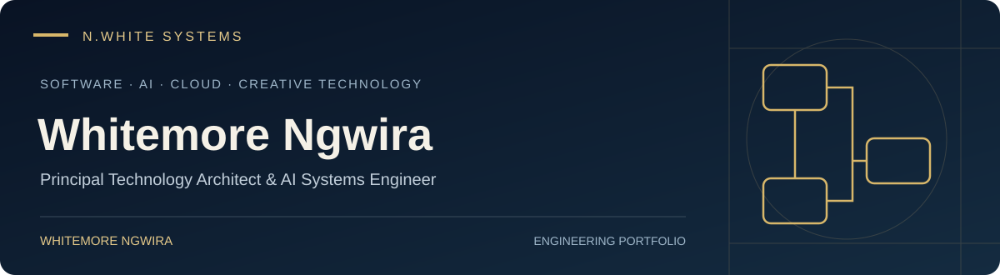
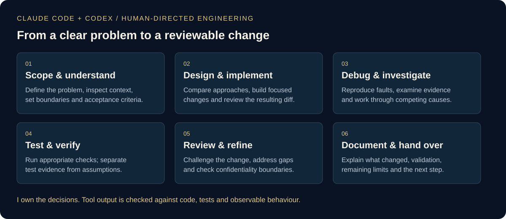
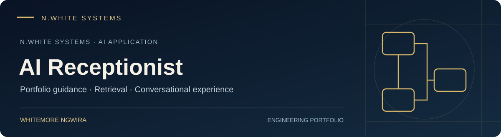

# Whitemore Ngwira

### Principal Technology Architect & AI Systems Engineer

*I design the systems behind the systems — including the systems that produce, process and deliver digital content.*

I work across **software engineering, AI-powered applications, cloud architecture and creative technology**. My experience connects hands-on Android and backend engineering with web platforms, AI-assisted development and the production workflows behind broadcast and digital media.

[Website](https://nwhite.systems/) · [About me](https://nwhite.systems/about-me) · [Portfolio index](https://github.com/whitemorengwira/nwhitesystems) · [Contact](mailto:hello@nwhite.systems)

**Explore:** [AI-assisted engineering](#software-engineering-with-claude-code--codex) · [AI applications](#ai-powered-applications) · [Sweet Robo](#sweet-robo--connected-machine-engineering) · [Enterprise platforms](#enterprise--digital-platforms) · [Broadcast & creative technology](#broadcast-film--creative-technology)

---

## Software engineering with Claude Code & Codex

I use **Claude Code** and **OpenAI Codex** as practical engineering tools across software development, debugging and delivery. I direct the work: defining the problem, deciding what should change, reviewing the implementation and checking the evidence.

This includes work on **Android kiosk applications, backend services, APIs, web platforms and AI-powered applications**. My approach connects agent-assisted implementation with tests, careful review and clear handovers.

| Part of the work | How I use the tools | My responsibility |
| --- | --- | --- |
| Understand & scope | Explore code, trace behaviour and identify affected components | Set the problem, boundaries and acceptance criteria |
| Design & build | Develop focused changes, compare options and refine implementation | Choose the approach and review the resulting code |
| Debug & investigate | Reproduce faults, inspect diagnostic evidence and test explanations | Distinguish observed behaviour from assumptions |
| Test & validate | Prepare and run appropriate regression checks, builds and CI checks | Assess what the results prove and what remains unverified |
| Review & improve | Challenge changes, examine edge cases and resolve findings | Decide whether the change is ready for review or handover |
| Document & hand over | Prepare technical explanations, change summaries and continuation notes | Keep the record accurate, useful and confidential |

**Examples from my recent engineering work:** Android resource and interface changes; diagnostic and test-APK work for connected machines; backend and API workflow improvements; automated quality checks; and conversational web experiences. I use agent workflows to maintain context across these tasks while keeping decisions and verification under human direction.

The diagram is an overview of my working method. It contains no internal instructions, private architecture or proprietary code.

---

## AI-powered applications

Alongside using AI to engineer software, I build and shape applications that put AI into user workflows: conversational assistance, evidence retrieval, document intelligence and guided task completion.

<table>
<tr>
<td width="50%" align="center" valign="top">
<a href="https://nwhite.systems/"> <strong>N.White Systems · AI Receptionist</strong></a> 
A conversational portfolio experience with retrieval from site information and fallback handling.
</td>
<td width="50%" align="center" valign="top">
<a href="https://github.com/whitemorengwira/nwhitesystems/blob/main/case-studies/applywise-ai.md"> <strong>ApplyWise AI · Career Workflows</strong></a> 
AI-assisted job analysis, career evidence, application preparation and interview workflows.
</td>
</tr>
</table>

These title cards are portfolio illustrations, not product screenshots.

- **N.White Systems:** AI receptionist and portfolio guidance, connecting conversational interaction with relevant site information.
- **ApplyWise AI:** career-workflow engineering, bringing role analysis, evidence-grounded assistance and draft review into an application experience.
- **[EarCodeX](https://github.com/whitemorengwira/earcodex-case-study):** a public architecture case study covering AI-enabled insurance document and claims workflows.
- **[Sweet Robo / Futureino AI Photo Booth app](https://github.com/whitemorengwira/sweet-robo-photo-booth):** AI-powered application engineering, including Android development, payment-related changes, debugging and diagnostics.
- **[AI-powered management platform](https://github.com/whitemorengwira/sweet-robo-control-centre-engineering):** AI solution contributions alongside backend and portal workflows, APIs and automated validation for connected machines.
- **[Remote diagnostics and camera-AI workflows](https://github.com/whitemorengwira/sweet-robo-control-centre-engineering#ai-powered-solutions):** AI solution work supporting connected-machine operations, described at a public portfolio level.

**My focus:** useful workflows, reliable integration, understandable results and human review. Each linked case study identifies its scope; a product's AI features do not imply that I authored its underlying AI models.

---

## Sweet Robo · Connected-machine engineering

I provide **AI-powered software solutions for Sweet Robo / Futureino**, including contributions to the **AI Photo Booth app**, the **AI-powered management platform**, and **remote diagnostics and camera-AI workflows**. My work also spans Android kiosks, hardware–software debugging, integration analysis, backend workflows and automated quality checks. These case studies explain my contributions within existing team-owned products, illustrated with official public product imagery.

**Official websites:** [Sweet Robo](https://sweetrobo.com/) · [Futureino](https://futureino.ai/)

| Showcase | My engineering contribution |
| :--- | :--- |
| [**Perfume Machine**](https://github.com/whitemorengwira/sweet-robo-perfume-machine) | Android engineering for self-service fragrance kiosks |
| [**Vending Machine**](https://github.com/whitemorengwira/sweet-robo-vending-machine) | Hardware–software integration analysis for automated retail |
| [**AI Photo Booth App**](https://github.com/whitemorengwira/sweet-robo-photo-booth) | AI-powered application engineering, Android development, debugging and diagnostics |
| [**Control Centre Engineering**](https://github.com/whitemorengwira/sweet-robo-control-centre-engineering) | AI-powered management, remote diagnostics and camera-AI workflows, backend systems and APIs |

<table>
<tr><td align="center" width="50%"><a href="https://github.com/whitemorengwira/sweet-robo-perfume-machine"> <strong>Perfume Machine</strong></a></td><td align="center" width="50%"><a href="https://github.com/whitemorengwira/sweet-robo-vending-machine"> <strong>Vending Machine</strong></a></td></tr>
<tr><td align="center" width="50%"><a href="https://github.com/whitemorengwira/sweet-robo-photo-booth"> <strong>AI Photo Booth App</strong></a></td><td align="center" width="50%"><a href="https://github.com/whitemorengwira/sweet-robo-control-centre-engineering"> <strong>Control Centre Engineering</strong></a></td></tr>
</table>

*Product visuals: Futureino. Management-platform visual: Sweet Robo. Each case study links to its official sources and distinguishes published product information from my engineering contributions. Proprietary code and non-public system details remain private.*

## Enterprise & digital platforms

These case studies explain my role, the product or business problem, and the public evidence available for review.

<table>
<tr>
<td width="50%" align="center" valign="top">
<a href="https://github.com/whitemorengwira/socinga-africa-enterprise-case-study"> <strong>Socinga Africa</strong></a> 
Multi-division enterprise website and stakeholder information architecture.
</td>
<td width="50%" align="center" valign="top">
<a href="https://github.com/whitemorengwira/earcodex-case-study"> <strong>EarCodeX</strong></a> 
Insurance architecture, AI document workflows and reconciliation case study.
</td>
</tr>
<tr>
<td width="50%" align="center" valign="top">
<a href="https://github.com/whitemorengwira/sam-dossier-case-study"> <strong>SAM Dossier</strong></a> 
Mining-investment dossier concept, dashboards and document-workflow design.
</td>
<td width="50%" align="center" valign="top">
<a href="https://github.com/whitemorengwira/nwhitesystems/blob/main/case-studies/safa-promax.md"> <strong>SAFA ProMax</strong></a> 
Board-facing creative technology, structured content and stakeholder experience.
</td>
</tr>
</table>

*Gallery images are generated portfolio visuals. Public screenshots, where available, are separately labelled inside the case studies.*

[Socinga Africa](https://www.socinga.africa/) · [Socinga Mining Hub](https://www.socinga.africa/mining-hub) · [EarCodeX](https://earcodex.vercel.app/) · [SAFA ProMax](https://safa-promax.vercel.app/) · [SAM Dossier](https://sam-dossier.vercel.app/)

---

## Broadcast, film & creative technology

My portfolio also spans colour grading, digital intermediate finishing, motion design, channel branding, multimedia production and delivery workflows across **21 productions and creative projects**.

Each image opens its project repository. These repositories bring together the existing production record, project visuals and reference architecture material. **The cloud and automation models are architectural demonstrations; they are distinct from claims about the infrastructure used on the original production.** My current use of Claude Code and Codex is not a claim that these tools were used on historical productions.

<table>
<tr>
<td width="50%" align="center" valign="top">
<a href="https://github.com/whitemorengwira/our-perfect-wedding-production-workflow"> <strong>Our Perfect Wedding</strong></a> 
Digital Intermediate, Finishing &amp; Broadcast QC DStv · Mzansi Magic Ch 161 (Connect TV) <a href="https://www.dstv.com/mzansimagic/en-za/show/our-perfect-wedding">Watch Highlights ↗</a>
</td>
<td width="50%" align="center" valign="top">
<a href="https://github.com/whitemorengwira/queendom-bet-africa-broadcast-workflow"> <strong>Queendom</strong></a> 
DI Pipeline, Precision Colour Grading, Network QC BET Africa · Paramount Africa Ch 129 (Clive Morris) <a href="https://www.youtube.com/watch?v=n-ysRQYivWE">Watch Highlights ↗</a>
</td>
</tr>
<tr>
<td width="50%" align="center" valign="top">
<a href="https://github.com/whitemorengwira/celebrity-mystery-box-post-pipeline"> <strong>Celebrity Mystery Box</strong></a> 
Colour Grading, DI Finishing &amp; Transmission Specs DStv · Mzansi Magic Ch 161 (Brightfire Pictures) <a href="https://www.dstv.com/mzansimagic/en-za/show/celebrity-mystery-box">Watch Highlights ↗</a>
</td>
<td width="50%" align="center" valign="top">
<a href="https://github.com/whitemorengwira/supabets-multimedia-asset-pipeline"> <strong>Supabets Gaming Group</strong></a> 
Dynamic Motion Graphics &amp; Digital Asset Pipeline Retail &amp; Digital Platforms <a href="https://www.supabets.co.za/">Explore the Work ↗</a>
</td>
</tr>
<tr>
<td width="50%" align="center" valign="top">
<a href="https://github.com/whitemorengwira/samf-documentary-production-workflow"> <strong>SAMF</strong></a> 
End-to-End Production, Archival QC &amp; Mastering Documentary · Archival &amp; Preservation <a href="https://www.youtube.com/watch?v=OHdA0_5XssQ">Watch the Film ↗</a>
</td>
<td width="50%" align="center" valign="top">
<a href="https://github.com/whitemorengwira/steward-bank-broadcast-campaign-workflow"> <strong>Steward Bank</strong></a> 
Commercial Spot Visualisation &amp; Animation Pipeline Banking Commercial Campaign (Quatrohaus) <a href="https://www.youtube.com/watch?v=mgTaIQ_p-h4&list=PLD973C175DAB62B58&index=15">Watch the Advert ↗</a>
</td>
</tr>
<tr>
<td width="50%" align="center" valign="top">
<a href="https://github.com/whitemorengwira/date-my-family-production-workflow"> <strong>Date My Family</strong></a> 
Episodic DI Finishing, Colour Grading &amp; QC DStv · Mzansi Magic Ch 161 (Connect TV) <a href="https://www.dstv.com/mzansimagic/en-za/show/date-my-family">Watch Highlights ↗</a>
</td>
<td width="50%" align="center" valign="top">
<a href="https://github.com/whitemorengwira/the-wife-showmax-grading-pipeline"> <strong>The Wife</strong></a> 
Episodic Colour Science, 4K HDR DI Workflow Showmax Original Series (Stained Glass TV) <a href="https://stories.showmax.com/za/originals/the-wife-series">Watch Highlights ↗</a>
</td>
</tr>
<tr>
<td width="50%" align="center" valign="top">
<a href="https://github.com/whitemorengwira/mkhonto-showmax-grading-pipeline"> <strong>Mkhonto</strong></a> 
Feature Film Cinematic DI Finishing &amp; Mastering Showmax Original Feature Film (M'Darkie Revolution) <a href="https://www.imdb.com/title/tt27827080/">Official Trailer ↗</a>
</td>
<td width="50%" align="center" valign="top">
<a href="https://github.com/whitemorengwira/prosek-corporate-motion-systems"> <strong>Prosek</strong></a> 
Corporate Motion Systems &amp; High-Tempo Post Global Financial Communications <a href="https://www.prosek.com/">Explore Prosek ↗</a>
</td>
</tr>
<tr>
<td width="50%" align="center" valign="top">
<a href="https://github.com/whitemorengwira/arise-south-africa-digital-infrastructure"> <strong>Arise South Africa</strong></a> 
Platform Architecture, Video Production &amp; Brand Integrated Multi-Channel Campaign <a href="https://www.arisesa.org/home">Visit ASA ↗</a>
</td>
<td width="50%" align="center" valign="top">
<a href="https://github.com/whitemorengwira/supa-tv-channel-branding-pipeline"> <strong>Supa TV</strong></a> 
On-Air Design Packaging &amp; Motion Systems OVHD Channel 150 <a href="https://www.youtube.com/channel/UCdjCmnuB6GWz5MCiOEb3LYA">Watch Highlights ↗</a>
</td>
</tr>
<tr>
<td width="50%" align="center" valign="top">
<a href="https://github.com/whitemorengwira/pastor-wants-a-wife-broadcast-workflow"> <strong>Pastor Wants A Wife</strong></a> 
Digital Intermediate, Colour Correction &amp; Online DStv · Mzansi Magic Ch 161 (Connect TV) <a href="https://www.dstv.com/mzansimagic/en-za/show/pastor-wants-a-wife">Watch Highlights ↗</a>
</td>
<td width="50%" align="center" valign="top">
<a href="https://github.com/whitemorengwira/brand-south-africa-20th-anniversary"> <strong>Brand South Africa</strong></a> 
Multi-Format Campaign Production &amp; Delivery National 20th Anniversary Campaign (Ebony+Ivory) <a href="https://brandsouthafrica.com/">Visit Brand SA ↗</a>
</td>
</tr>
<tr>
<td width="50%" align="center" valign="top">
<a href="https://github.com/whitemorengwira/jit-tv-channel-branding-pipeline"> <strong>Jit TV</strong></a> 
On-Air Identity, Motion Graphics &amp; Title Sequences Regional Broadcaster <a href="https://jit-tv.tv/">Watch Highlights ↗</a>
</td>
<td width="50%" align="center" valign="top">
<a href="https://github.com/whitemorengwira/zodiak-tv-malawi-channel-branding"> <strong>ZODIAK TV</strong></a> 
On-Air Motion Design System &amp; Transmission QC Malawi National Broadcaster <a href="https://www.zodiakmalawi.com/">Watch Highlights ↗</a>
</td>
</tr>
<tr>
<td width="50%" align="center" valign="top">
<a href="https://github.com/whitemorengwira/times-tv-malawi-channel-branding"> <strong>TIMES TV</strong></a> 
Channel Branding &amp; Post-Production Management Malawi Commercial Television <a href="https://times.mw/tag/times-television/">Watch Highlights ↗</a>
</td>
<td width="50%" align="center" valign="top">
<a href="https://github.com/whitemorengwira/soico-tv-mozambique-branding"> <strong>Soico Televisão</strong></a> 
On-Air Identity Modernisation &amp; Station IDs Mozambique Commercial Network <a href="https://www.stvplay.co.mz/browse">Watch Highlights ↗</a>
</td>
</tr>
<tr>
<td width="50%" align="center" valign="top">
<a href="https://github.com/whitemorengwira/tv-miramar-mozambique-branding"> <strong>TV MIRAMAR</strong></a> 
Broadcast Motion Graphics &amp; Title Sequences Mozambique (Record TV Network) <a href="https://miramar.co.mz/tv-online">Watch Highlights ↗</a>
</td>
<td width="50%" align="center" valign="top">
<a href="https://github.com/whitemorengwira/opw-zimbabwe-broadcast-workflow"> <strong>OPW Zimbabwe</strong></a> 
DI Colour Grading &amp; Post-Production Training DStv · Zambezi Magic Ch 162 (Ngoda TV) <a href="https://www.dstv.com/zambezimagic/en-za/show/our-perfect-wedding-zimbabwe/season/1">Watch Highlights ↗</a>
</td>
</tr>
<tr>
<td width="50%" align="center" valign="top">
<a href="https://github.com/whitemorengwira/who-is-like-you-music-video-grading"> <strong>Who Is Like You</strong></a> 
Cinematic Finishing &amp; Colour Science Music Video (Direct Worship / Ngoda TV) <a href="https://www.youtube.com/watch?v=IHOSPLDXISM&list=RDIHOSPLDXISM&start_radio=1">Watch Music Video ↗</a>
</td>
<td width="50%"></td>
</tr>
</table>

*Production artwork and logos retain their respective owners' rights. They identify the projects discussed; case studies describe my contribution and reference-architecture scope.*

[Explore the full multimedia portfolio](https://nwhite.systems/my-portfolio/multimedia)

---

## Technology & engineering practice

| Area | Tools and focus |
| --- | --- |
| AI-assisted software engineering | Claude Code, OpenAI Codex, code review, debugging, tests and structured handovers |
| AI applications & automation | Conversational interfaces, retrieval-augmented workflows, model integration, MCP and Python |
| Android & connected machines | Kotlin, Android applications, kiosk workflows, integration analysis and diagnostic engineering |
| Web & backend systems | TypeScript, React, Next.js, APIs, service workflows and automated quality checks |
| Cloud & delivery | AWS, Azure, GCP, Cloudflare, Terraform, Docker and GitHub Actions |
| Creative & broadcast systems | DaVinci Resolve Studio, colour workflows, FFmpeg, motion design, technical QC and delivery |

## Professional integrity

This profile presents selected public work, sanitised case studies and illustrative diagrams. It separates my contribution from team-owned products and distinguishes reference designs from verified delivery.

Private code, internal agent instructions, customer records and proprietary implementation details are excluded from these portfolio updates. Technical walkthroughs are available where permission and confidentiality allow.

[Public disclosure policy](https://github.com/whitemorengwira/nwhitesystems/blob/main/PUBLIC_DISCLOSURE_POLICY.md)

## Contact

[**nwhite.systems**](https://nwhite.systems/) · [**hello@nwhite.systems**](mailto:hello@nwhite.systems?subject=Engineering%20portfolio%20walkthrough)

*© N.White Systems. Published for professional portfolio review.*
